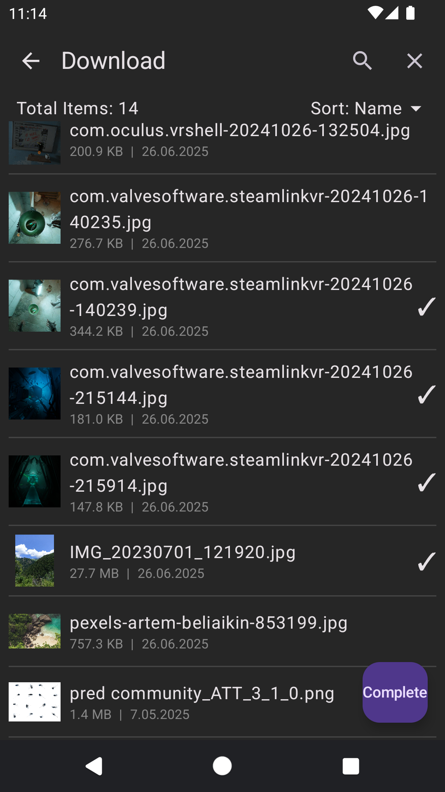
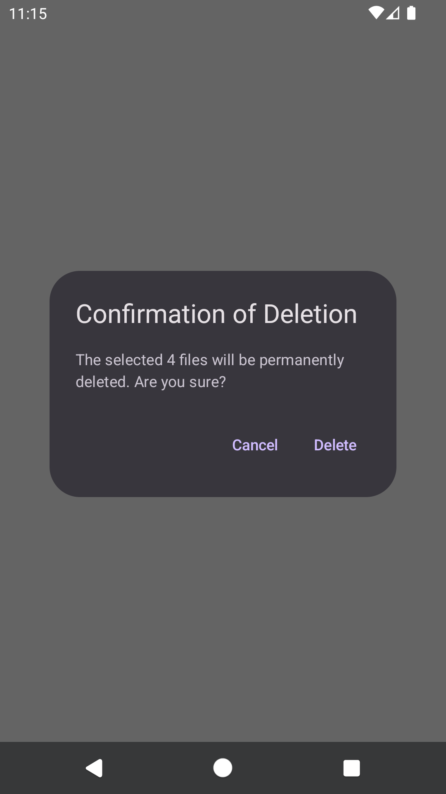
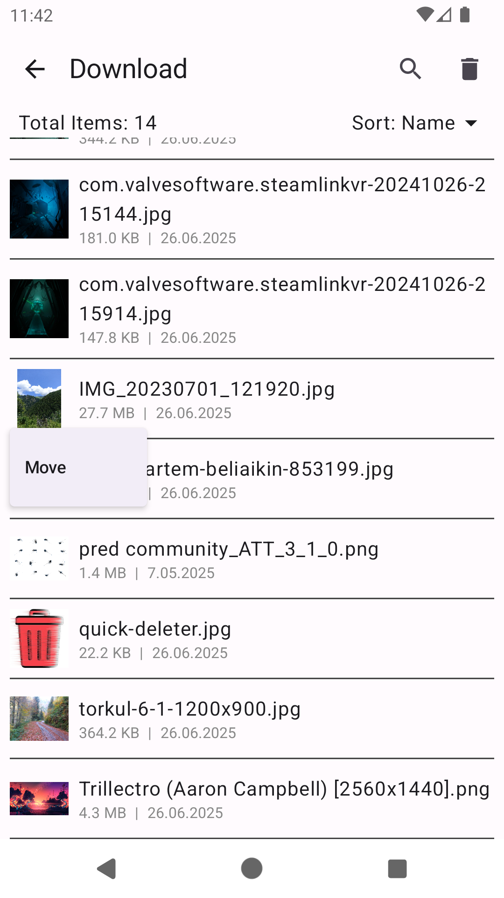
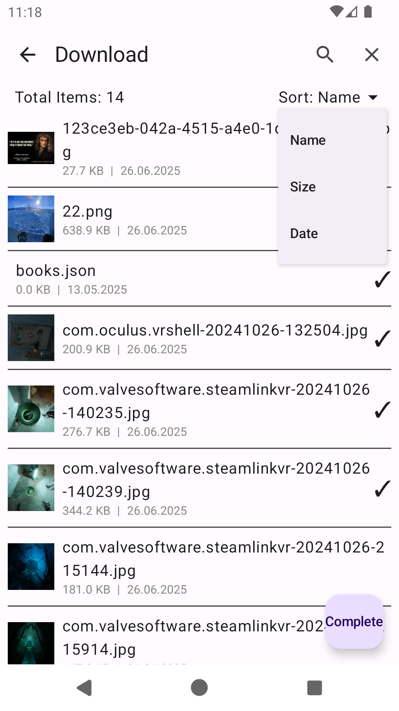

# 📁 QuickDeleter

**QuickDeleter** is a mobile application developed for quickly browsing, selecting, and deleting files on Android devices. With its user-friendly interface, users can navigate directories, preview images, view file details, and easily remove unnecessary content.

---

## 🚀 Features

- 📂 Browse internal storage with a breadcrumb path bar — tap a folder to open it
- 🗑️ **Selection mode**: select files and delete them in one action
  - Every folder keeps its own selection: when you act in another folder, files selected elsewhere are excluded, and they are still selected when you come back
- ↩️ **Undo delete**: deleted files can be restored for a few seconds from the snackbar
- 📦 **Move files** to another folder (long press → Move), with a "Replace / Keep both" prompt when the name already exists and the option to create a folder on the way
- ✏️ Rename files, create folders
- 🖼️ Image thumbnails and a details view with a large preview (JPG, PNG, WEBP, GIF, HEIC…)
- 🔍 Search inside the current folder
- ↕️ Sort by Name, Size or Date (ascending/descending) — folders always stay on top
- 🙈 Show/hide hidden files, hide empty folders
- 🌙 Light and dark theme, English and Turkish UI
- 🔄 State survives rotation and process death (current folder, selection, sort)

## 📸 Screenshots

<table>
  <tr>
    <td align="center">
      🗑️ <strong>Deletion Mode</strong><br/>
      <br/>
    </td>
    <td align="center">
      ✅ <strong>Delete Confirmation</strong><br/>
      <br/>
    </td>
  </tr>
  <tr>
    <td align="center">
      📂 <strong>Move Files</strong><br/>
      <br/>
    </td>
    <td align="center">
      ↕️ <strong>Sort Files</strong><br/>
      <br/>
    </td>
  </tr>
</table>

---

## 🧱 Project structure

```
app/src/main/java/com/enestopal/quickdeleter/
├── data/            # Pure Kotlin, no Android dependencies (unit tested)
│   ├── FileItem.kt        # Immutable file snapshot + file type detection
│   ├── FileOperations.kt  # list / move (conflict safe) / rename / create folder
│   ├── Trash.kt           # Short-lived trash that powers "Undo"
│   ├── Selection.kt       # Per-folder selection model
│   └── SortOption.kt      # Sorting and filtering
└── ui/
    ├── browser/     # BrowserViewModel (StateFlow + SavedStateHandle), BrowserScreen, FileRow
    ├── move/        # Destination picker
    ├── permission/  # "All files access" handling
    ├── components/  # Dialogs, thumbnails, empty states, formatters
    └── theme/
```

All disk access runs on `Dispatchers.IO`; composables only read immutable `FileItem` snapshots.

---

## ⚙️ Building

Requirements: Android Studio (latest stable), JDK 17, Android SDK 36.

```bash
git clone https://github.com/EnesTopal/quick-deleter.git
cd quick-deleter
./gradlew testDebugUnitTest   # unit tests
./gradlew lintDebug           # Android lint
./gradlew assembleDebug       # debug APK (package: com.enestopal.quickdeleter.debug)
```

### Release signing

Create a `keystore.properties` file in the project root (it is git-ignored):

```properties
storeFile=release.jks
storePassword=...
keyAlias=...
keyPassword=...
```

or provide `QD_KEYSTORE_FILE`, `QD_KEYSTORE_PASSWORD`, `QD_KEY_ALIAS`, `QD_KEY_PASSWORD` as environment
variables. Then run `./gradlew bundleRelease`. CI (GitHub Actions) runs tests, lint and the release
build on every push and pull request; add the `QD_KEYSTORE_BASE64` secret (base64-encoded keystore)
plus the password/alias secrets to get signed artifacts.

### Permissions

QuickDeleter is a file manager and needs **All files access** (`MANAGE_EXTERNAL_STORAGE`). When the
permission is missing the app shows an explanation screen with a button to the system setting and
re-checks automatically when you come back. For Google Play, this permission must be declared under
the *file manager* use case. See [PRIVACY.md](PRIVACY.md).

---

© 2025 Enes Topal. MIT License.
